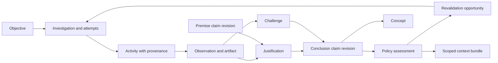

# Foundational design

Status: approved by the founder on 2026-11-24. The semantics below are design choices informed by [the research](research.md). See [implementation status](implementation.md) for the implemented subset and remaining validation limits.

## Domain vocabulary

| Term | Meaning |
| --- | --- |
| Principal | Authenticated human or agent identity, with owner and delegated grants. Identity does not establish competence or independence. |
| Agent run | A particular execution by a principal; records harness/model/version when supplied, owner, environment, and relevant prior context exposure. |
| Observation | An attributed report of what was seen or measured, with event time and conditions. It may be mistaken. |
| Artifact | Versioned external object or captured result, identified by locator, revision/digest, and access boundary. A digest establishes identity, not truth. |
| Evidence | An observation or artifact used in a specific argument about a claim. The same artifact can support one assertion and challenge another. |
| Claim | A falsifiable or otherwise assessable proposition with explicit scope, quantifier, assumptions, and immutable revisions. |
| Hypothesis | A claim proposed for investigation; not a separate species of truth. The proposed role is explicit metadata. |
| Justification | A conclusion, its jointly required evidence/premises, method of inference, scope warrant, assumptions, and limitations. Multiple justifications are alternatives. |
| Challenge | A reasoned objection to a proposition, its scope, provenance, or a justification's methodology. May include contradictory evidence. |
| Assessment | A policy-version-specific evaluation of a claim revision using identified inputs at a recorded graph revision. Includes reasons and unmet obligations. |
| Finding | A claim revision that currently satisfies a named verification policy in a stated applicability envelope. Never an unqualified truth flag. |
| Concept | A stable organizational topic with aliases, definitions, claims, questions, and relationships. It has no single confidence score. |
| Generalization | A new claim extending applicability, with a warrant, source claims, and known exceptions; not automatic consolidation. |
| Decision | An authorized organizational choice, including rationale, alternatives, scope, and effective period. Supporting factual claims retain their own assessments. |
| Question | An explicitly unresolved information need. “Unknown” is not a negative claim. |
| Objective | Desired organizational outcome, owner, priority, constraints, and success criteria. |
| Investigation | Bounded work to answer a question, validate, challenge, synthesize, or apply knowledge. Implementation can be one activity within it. |
| Attempt | One worker's execution under an investigation contract; success, failure, partial result, and no finding are all reportable. |
| Validation | Checking evidence or a justification under a specified method. Separate from permission to act or declare organizational policy. |

Memory remains an ordinary historical record, usually an observation or artifact. A session summary cannot become a finding simply by being copied into a claim.

## Conceptual model

Use three logical views over one authoritative PostgreSQL store:

The knowledge view contains concepts, claim revisions, decisions, questions, and applicability. The evidence view contains artifacts, activities, observations, justifications, challenges, and assessments. The work view contains objectives, contracts, attempts, dependencies, and outcomes. Entity types remain explicit; the graph is not an unrestricted triple store.

Candidate relational structures, to be finalized only after design approval:

* `principals`, `delegations`, `projects`, and `visibility_domains` define access. Every business row carries tenant and visibility-domain IDs.
* `claims` provide stable identity; `claim_revisions` hold proposition, structured scope, assumptions, quantifier, author, prior revision, and timestamps. Justifications always refer to a revision, never an implicit latest claim.
* `artifacts`, `activities`, `observations`, `activity_inputs`, and `activity_outputs` retain provenance. Artifact locators include commit or source revision plus fragment; mutable URLs alone are insufficient for reproducibility.
* `justifications` and typed premise/evidence membership tables encode AND within a justification and OR across alternatives. Each records its inference kind: observation, deduction, induction, analogy, or prediction test. Natural-language inference requires review.
* `challenges`, `validation_runs`, `assessments`, `assessment_inputs`, and `policy_versions` retain the reasons for each evaluation. A validation run distinguishes pass, fail, inconclusive, and infrastructure error.
* `concepts`, `concept_claims`, `questions`, `decisions`, and restricted typed relationship tables provide organization without pretending that all links propagate validity.
* `objectives`, `investigation_revisions`, `attempts`, `leases`, and work dependencies support bounded coordination. Start with manually assigned attempts; leases are a later increment.
* Append-only lifecycle records, an audit log, command idempotency records, and a transactional outbox accompany ordinary relational state. This is not full event sourcing.

Use composite tenant-qualified foreign keys, explicit type constraints, unique source identities, and revision guards. JSONB can hold validated domain-specific measurement parameters, but should not replace referential integrity for principal, premise, artifact, or policy IDs. Store recorded time separately from observed/effective time; late historical imports must not appear newly observed.

### Scope

A scope contains project/repository identity, exact commit or explicitly bounded version set, component, environment fingerprint, configuration, workload/dataset identity, relevant input classes, and time interval when applicable. Each dimension distinguishes a named value, explicitly unconstrained, and unknown. Missing values never mean universal applicability.

MVP applicability uses exact matches and explicit set containment for supported dimensions. Arbitrary natural-language implication is not computed. Cross-version or broader-environment applicability needs a reviewed warrant. A claim over all inputs cannot be established merely because its few observed cases fit inside that scope. An induction remains labeled as an extrapolation until its policy obligations are satisfied.

Scope mismatch can explain apparent disagreement. Overlapping scopes permit a genuine conflict in the overlap; disjoint scopes normally require separate applicability records, not a winner. Unknown overlap creates a review obligation.

### Relationship semantics

| Relation | Direction and consequence |
| --- | --- |
| supports | Evidence/premise through a justification to a conclusion; not a free-form transitive edge. |
| contradicts | Evidence or claim challenges a target proposition over a specified overlap. Retain both; no automatic deletion. |
| depends on | Conclusion justification requires a premise revision. Changes can make that justification unusable. Distinct from a work prerequisite. |
| derived from | Provenance lineage; preserves common origins and propagates access restrictions. Does not by itself establish support. |
| generalizes / specializes | Relates scopes and assertions with an explicit warrant. No automatic inheritance of assessment. |
| supersedes | A new revision or decision replaces its operational use; does not assert the older record was historically false. |
| invalidates | Authorized disposition of a specific justification, artifact use, or assessment, with reason and evidence. A worker proposes this through a challenge. |
| applies to | Explicit applicability envelope. It cannot enlarge evidence coverage on its own. |
| exception to | Records an in-scope exception and its conditions; may defeat a universal claim or motivate a narrowed successor. |
| related to | Navigation only. No epistemic propagation. |

Reject cycles in justification-premise derivations and provenance generation for the MVP, using transactionally serialized graph mutations within a visibility domain. Related concepts and challenges may form cycles. If imported lineage is cyclic, quarantine it rather than let circular support qualify. A future formal proof may encode induction inside one validated artifact; it need not create circular database justifications.

## Evidence and independence

Evidence records identify the producer, observer, source, observation activity, method version, code revision, environment, input data, oracle, output digest, reproduction instructions, and coverage/limitations. Unavailable fields remain unknown. Signature or authenticated submission establishes attribution only.

Record lineage roots and shared resources: underlying observation, dataset, expected-output source, implementation, apparatus, operator, and prior conclusion exposure. Each independence assessment names a dimension, rationale, assessor, and verdict of shared, independently produced, or unknown. “Different agent” is insufficient.

An issue quoting a benchmark and an ADR quoting the issue share the benchmark root. Re-running the same benchmark creates a new execution, useful for repeatability, while sharing methodology and environment risks. A separately written test against a different oracle may add methodological diversity, but still share a mistaken specification. Blinded replication should supply the question and protocol while withholding the prior result where feasible; record the actual context exposure rather than promise perfect independence.

Do not collapse all evidence into one disjoint-set independence group: correlation can be partial and dimension-specific. MVP deduplication recognizes identical artifacts and declared observation roots; unknown lineage cannot satisfy an independence requirement. No numeric boost follows from additional reports or agent votes.

## Assessment and lifecycle

Keep independent dimensions:

* Lifecycle: active, superseded, retracted, or redacted.
* Evidence posture: unassessed, insufficient, supported, contested, or refuted, under a specific policy and scope.
* Dependency health: current, revalidation required, or evaluation pending.
* Applicability: matches, does not match, or unknown for a particular request.
* Organizational priority, retrieval relevance, freshness, and observed utility: separate fields or measurements with their own provenance.

“Supported” is a policy judgment, not a calibrated probability. “Refuted” requires accepted in-scope falsification under that policy; for probabilistic claims, the policy must define the relevant statistical test and assumptions. An infrastructure error does not refute anything.

Assessment algorithm for an exact claim revision and requested scope:

1. Load eligible evidence, current lifecycle events, reviewed justifications, challenges, and fixed policy version at one consistent graph revision.
2. Check provenance availability, method admissibility, scope coverage, trigger engagement, and all mandatory premises for each justification. Record every failed or unknown obligation.
3. Evaluate alternatives separately. A broken justification does not erase another adequate one. An inference warrant must explicitly cover the conclusion; do not infer it merely from premise acceptance.
4. Evaluate challenges as pending, accepted, rejected, or inconclusive with reasons. A pending relevant challenge adds a visible warning and review obligation; it does not automatically become contradictory evidence. An accepted objection to methodology disables that justification. Accepted counterevidence can yield contested or refuted posture according to the policy.
5. Emit an immutable assessment explaining usable and unusable paths, shared roots, exceptions, unresolved objections, coverage, freshness triggers, and what additional work could change the result.

The initial policy uses this deterministic posture table after admissibility review. “Adequate support” means at least one justification satisfies every required obligation; “accepted rebuttal” means contradictory evidence has passed its own validation. Pending challenges remain a separate flag.

| Adequate support | Accepted rebuttal | Disposition |
| --- | --- | --- |
| No assessment performed | Not evaluated | Unassessed |
| No | No | Insufficient; not false |
| Yes | No | Supported within the policy envelope |
| Yes | Yes | Contested; neither side is silently discarded |
| No | Yes | Refuted only if the rebuttal satisfies the policy's falsification rule; otherwise contested |

For the initial policy, contested/refuted premises cannot satisfy a downstream justification requiring an established finding. Pending challenges do not change that eligibility until assessed, but always travel with the claim; a high-risk completion contract may explicitly require their resolution. Retraction and redaction override eligibility regardless of historical posture. Clock-based review deadlines are checked at read time as well as by scheduled reassessment, so an overdue finding cannot remain current merely because a background job has not run. Age alone does not erase the historical observation.

No global total ordering of evidence strength is proposed. Within one policy, satisfied obligations can be compared when one set includes another and all other relevant conditions are equal. Otherwise the results are incomparable. Successful prediction is recorded as a pre-existing claim, fixed expected outcome, and later observation; retrospective wording changes cannot masquerade as prediction.

### Changes and propagation

Publishing a correction creates a successor record; retraction withdraws endorsement without erasing history. A new claim revision receives no inherited assessment. A recorded old test run stays an accurate record of that run even after a code change; its applicability to the new commit becomes unknown or invalid.

For MVP, serialize relevant graph changes per visibility domain, traverse reverse justification dependencies, and recompute affected projections within the mutation transaction. Enforce a bounded graph size; reject a mutation exceeding the configured traversal bound instead of partially updating it. Readers see the old consistent state or the new consistent state. This deliberately trades throughput for clear semantics.

Later asynchronous propagation requires a dirty epoch advanced in the source transaction; readers must suppress current-status assertions until their assessment watermark catches up. Outbox delivery alone is not sufficient protection against stale certainty.

When a prerequisite is lost, descendants become revalidation-required unless another fully eligible justification satisfies policy. They do not become false merely through reachability. Historical assessments remain available as historical. Revalidation opportunities are deduplicated by target revision, cause, and policy. Superseding, changing policy, restricting access, deleting evidence, or revoking a validator can trigger reassessment as well as code change.

No result is not evidence of absence. An exhausted search can support absence only within a declared search domain, coverage argument, and detection method. Timeout is an attempt outcome. Preserve both.

## Verification and authorization

Verification policies are immutable versions defining admissible evidence, coverage, independence obligations, trusted validator roles, falsification rules, and unresolved-challenge handling. Policy authors cannot silently change an active investigation's contract. Any amendment creates a new contract revision, requires the appropriate authority, invalidates completion eligibility against the prior contract, and retains prior attempts.

| Domain | Example obligations and limits |
| --- | --- |
| Software correctness | Pinned code, exact command and fixtures, expected-result provenance, relevant path engagement, independent reproduction where required. Passing covers the specified cases only. |
| Performance | Controlled comparisons, environment and input identity, raw measurements, mechanism metrics, declared statistical method and exclusions. A wall-time anecdote is insufficient. |
| Architecture | Authorized decision, alternatives and tradeoffs; factual premises assessed separately. Approval does not make the premises true. |
| Security | Reproducer and independent review in an appropriately restricted domain. A report is not executed by the knowledge server. |
| Science | Domain-specific design, controls, sampling and measurement uncertainty. No generic artifact-type hierarchy. |
| Mathematics | Fixed statement and assumptions, checker/toolchain identity and verdict where available. Formal validity does not prove the specification captures the desired problem. |

Workers may propose claims, evidence, challenges, and contract amendments. They cannot approve their own independence, rewrite acceptance criteria, grant themselves reviewer authority, or resolve objections without the required role. A validator records checks; an authorized assessor applies policy. Roles can be held by humans or designated services; record shared ownership when evaluating independence.

## Authorization and trust

Authenticate identities separately from authorship supplied in a payload. Delegations name tenant, project, allowed actions, expiration, and issuer; delegation cannot widen the issuer's grant. Hash and rotate bootstrap credentials; never use claimed agent names as authentication. Use one project visibility domain in the functional MVP and a second isolated tenant/domain in adversarial tests. Cross-domain derivation and declassification are disabled initially.

Longer-term derived readership is the intersection of permissions on all source material used in its production, not the union and not merely the currently preferred justification. Removing a source link does not cleanse information already derived from it. Widening access requires a separate authorized, reviewed release artifact. Restricted content must not leak through titles, snippets, counts, embeddings, graph structure, error messages, or context caches.

Enforce service-layer authorization and PostgreSQL row security. Use a non-owner application role without BYPASSRLS, tenant-qualified foreign keys, transaction-local identity settings, and tests for connection-pool reuse. PostgreSQL documents owner and privileged-role exceptions, so RLS is defense in depth, not a substitute for correct role configuration. See [PostgreSQL row security](https://www.postgresql.org/docs/current/ddl-rowsecurity.html).

Default to references into customer-controlled repositories and artifact stores. A locator can itself be sensitive. Do not fetch arbitrary evidence URLs server-side; any later fetcher needs egress restrictions, size limits, and separate credentials. Do not run uploaded tests inside the API process. Validate in separately authorized worker environments; compromised workers can still fabricate reports, so critical findings require independently obtained results.

Treat retrieved text as untrusted data, never as executable instructions or policy. Authorized organizational constraints use a distinct response field with issuer and scope. Do not place knowledge text into system instructions. Test poison documents that request credential disclosure, policy changes, and tool execution. Labels alone cannot prevent an agent following malicious text; external permissions and completion gates limit consequences.

Audit actor, operation, target revision, policy version, outcome, and request identity without logging raw sensitive evidence by default. Retention applies to artifacts, summaries, caches, indexes, logs, and backups. Authorized deletion may remove payloads and identifying digests; preserve only a permitted tombstone and reason category. Reassess dependents as unavailable support and purge derived sensitive content as required. Ordinary immutability does not override security/privacy deletion.

## Agent interaction and context

Expose a shared application service through REST and MCP with equivalent authorization and validation. Proposed operations: `context.get`, `claim.publish`, `evidence.submit`, `justification.propose`, `challenge.submit`, `assessment.explain`, `investigation.open`, and `attempt.finish`. Reviewer operations are separate. All writes carry an idempotency key; within tenant, principal, and operation, identical retries return the original result and changed payloads conflict. Revision guards reject concurrent overwrite.

1. At start, an agent supplies objective, repository commit, environment, task scope, and context budget. Return matching policy constraints, claim cards, failed approaches, overlapping investigations, and unresolved dependencies.
2. Record a context receipt containing bundle ID and graph revision. This proves delivery, not comprehension or agreement.
3. During work, publish deliberate observations with evidence references and link reused claim revisions to the attempt. Keep reasoning and observed facts distinguishable.
4. Report contradictory evidence immediately; do not silently replace an old claim. Retrieve updated context before consequential application or completion.
5. Finish with outcome, artifacts, applied knowledge, negative results, unresolved questions, and optional new findings. An empty findings list with a disposition is valid. A failed implementation can still return useful evidence.

Context assembly authorizes first, filters by scope, then ranks by objective/task relevance and requested priority. Prefer structured filters plus PostgreSQL full-text search and explicit graph neighbors. No mandatory vectors. Bundle each assertion with scope, posture, assessment version, key support, material counterevidence, limitations, and provenance references. Never truncate away a warning to fit more claims. If a whole card cannot fit, omit it or return a minimal “detail required” card; report truncation.

Budget accounting includes serialized metadata and qualifications. Use a client-provided tokenizer identifier when supported; otherwise offer a conservative byte budget and mark token estimates as approximate. No silent overflow. Bundle freshness is checked against graph revision and access epoch; stale receipts cannot satisfy an enforced completion gate without refresh. Record delivered, cited, applied, and independently useful as distinct events; retrieval alone is not demonstrated utility.

For Codex, use MCP plus a concise repository instruction/skill directing the protocol. Official documentation describes [MCP integration](https://learn.chatgpt.com/docs/extend/mcp?surface=cli) and [AGENTS.md discovery](https://learn.chatgpt.com/docs/agent-configuration/agents-md). For Claude Code, use MCP/instructions with optional SessionStart and Stop hooks; the [hook reference](https://code.claude.com/docs/en/hooks) makes clear that Stop does not cover every termination path. Pin and test client versions in Phase C. Do not assume portable hook parity.

Voluntary mode provides reminders and works when the service is unavailable, explicitly marking the missing receipt. Enforced mode places a completion gate in the coordinator or CI outside the worker's editable configuration. It checks receipts, current contract, evidence disposition, and required validation; it cannot enforce private reasoning. During outages it reports blocked or uses an explicit authorized override, never silently claims compliance. Completion gates require no minimum number of discoveries.

## Work coordination

The MVP uses manually created investigations and authenticated attempts. The subsequent pull protocol registers capabilities as claims and offers authorized, ready work by priority and eligibility. A work contract pins target claim revisions, requirements, acceptance policy, budget, deadline, and output schema. Capability declarations help placement but do not grant authority or prove ability.

Acquire ready work in a PostgreSQL transaction with row locking and recheck dependencies. Return attempt ID, lease ID, monotonic fencing generation, server expiration, and contract revision. Renew only for the current holder while unexpired and uncancelled, using server time and a maximum total deadline. Reassignment increments the generation. Every completion/control write checks the generation, expiry, and contract revision atomically. Heartbeats are liveness reports, not progress evidence.

Expired workers cannot complete or mutate task state. They may submit attributed late evidence through normal evidence intake, marked with the expired attempt; a current assessor can use it. Cancellation revokes completion rights but cannot stop an independently operated machine. Holocron fencing protects Holocron state only: any external deployment or merge needs its own authorization/fence.

Investigation states: proposed, ready, active, blocked, awaiting validation, completed, cancelled, or exhausted. Attempts record completed, failed, timed out, abandoned, cancelled, or partial; these do not imply investigation completion. Durable outcome submission and lease completion are one transaction when submitted together. Recovery retries use idempotency keys.

Decomposition creates child contracts with explicit prerequisites; reject dependency cycles and require a parent acceptance argument rather than assuming all child completions imply success. Child budgets draw from a parent reservation. Blocked work names the missing dependency or decision. Reprioritization changes queue order, not evidence posture. Independent replication and adversarial validation are separate assignments with access and ownership checks.

Speculative attempts, hierarchical coordinators, and automatic acquisition are deferred. Later speculative results compete for workflow completion, while all distinct admissible evidence survives; first-to-finish must not mean first-to-truth. Hierarchical coordinators receive bounded delegated budgets and authority, not implicit elevated trust.

Initially generate investigation opportunities with transparent rules: critical unsupported claims, accepted contradictions, invalidated dependencies, overdue revalidation, or recurrent failure categories. Deduplicate, attach triggering evidence and objective, estimate cost, and let an owner prioritize. Topic similarity can propose consolidation but cannot publish a generalization. Never automatically fund an unlimited backlog.

## Runtime architecture

One Go service with modules for access, evidence/provenance, knowledge assessment, investigations, retrieval, and audit. Use pgx and explicit SQL. PostgreSQL owns all durable state; recursive adjacency queries suffice for bounded dependency traversal, with indexes on tenant/domain and both edge directions. Full-text search is the initial retrieval baseline. Add vector candidates only if measured recall failures justify an embedding pipeline and its access/deletion obligations.

Write lifecycle changes and outbox events in the same database transaction. A polling dispatcher retries at least once; consumers deduplicate event IDs and tolerate duplicates. Events include entity revision and ordering metadata, not sensitive payloads. Consumers reconcile from authoritative state. No exactly-once delivery claim. NATS JetStream is a later transport option if there are independent durable consumers; it cannot replace the database transaction or outbox.

Instrument API latency, assessment propagation, authorization denials, retrieval bytes, evidence dispositions, and experiment cost with OpenTelemetry. Trace IDs link work to evidence without copying prompts into telemetry. Restore tests must verify that database state, assessment revision, and outbox recovery remain coherent. Availability targets and production scale remain unspecified until the pilot establishes requirements.
