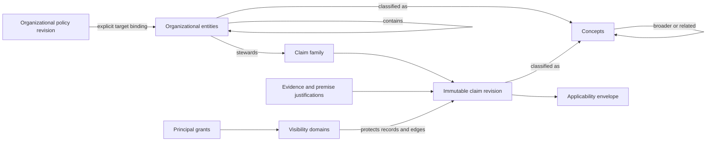

# Hierarchical knowledge architecture

Status: **foundational semantics approved**, 2026-11-24. Implementation is limited to the single-domain slice described in [the release notes](hierarchy-release.md) and ADR 018. This architecture also describes later capabilities that remain deferred. Companion documents contain [ADRs](hierarchy-decisions.md) and the [implementation and validation plan](hierarchy-validation.md).

## Recommendation

Add organizational containment and conceptual classification as discovery structures over existing claim revisions. Preserve applicability, justification, and authorization as separate decisions. A retrieved claim must report both its assessed conditions and whether those conditions cover the current request.

Use PostgreSQL adjacency tables with bounded traversal. Begin with several projects and concepts inside one existing visibility domain. Add explicit multi-domain grants and revocation-safe context delivery before enabling shared catalogs spanning security boundaries. Keep cross-domain evidence derivation and declassification disabled until their separate controls are tested.

The hierarchy is not a model of intelligence. Its value is a testable reduction in missed relevant knowledge, redundant investigation, and authoring friction. A flat search may outperform it on some workloads.

## Findings from the existing system

| Inspected source | Current behavior | Required architectural consequence |
| --- | --- | --- |
| [Schema](../internal/platform/schema.sql) and [transaction setup](../internal/platform/store.go) | A principal credential selects one tenant and one visibility domain. References include both; RLS checks a transaction-local domain. | An organizational taxonomy cannot be implemented by reinterpreting `domains`. Multi-domain retrieval needs an explicit grant model and consistent authorization snapshot. |
| [Scope and claim input](../internal/platform/types.go) | Scope requires repository, full Git object ID, environment, configuration, dataset, oracle, and named cases. Concepts are strings embedded in immutable claim input. | General engineering knowledge needs a separate versioned applicability envelope. Classification needs stable IDs and independently versioned associations. Empty repository fields cannot become wildcards. |
| [Context assembly](../internal/platform/context.go) | It first loads the current domain graph, ranks all claims by full-text relevance, and retains exact-environment case coverage. Zero lexical matches can still fill the bundle. | Introduce authorization-filtered candidate generation and relevance gates. Hierarchical orientation must not be represented as an exact local finding. |
| [Assessment](../internal/platform/graph.go) | One fixed finite-case policy, AND premises, alternative justifications, explicit review and shared-origin checks. Only `finite_cases` can qualify. | Keep the evaluator unchanged initially. A hierarchy label cannot make a generalization pass this policy. Cross-context synthesis requires a separately specified policy. |
| [Command replay](../internal/platform/store.go) | After authentication, an exact idempotent retry returns saved response bytes before dispatch. | Future grant revocation or reclassification must be checked before replaying those bytes. Old receipts are not access capabilities. |
| [Completion](../internal/platform/work.go) | Completed attempts require a receipt from the current domain epoch, matching scope and author, and optional support/challenge gates. | Multi-domain receipts need a server-side version vector and explicit treatment of orientation versus locally applicable facts. |
| [Revocation and purge](../internal/platform/migrate.go) | Credential revocation also affects participant eligibility; purge enumerates current tables and deletes a whole domain. | Separate access-grant loss from evidence distrust. Extend deletion and restore handling to every new association, cache, receipt, and release artifact before deployment. |
| [Live pilot](live-pilot.md) | Actual agents found missing evidence attachment and identity/build provenance; fixture claims polluted context; immutable prose retained an obsolete assessment disclaimer. | Require explicit associations, preserve provenance during compression, gate irrelevant candidates, and keep changing status out of proposition text. |

The proposed cache changes address a risk created by richer authorization. The current all-or-nothing credential revocation blocks authentication; this review does not claim an already-demonstrated partial-grant leak in the existing single-domain service.

## Prior art and boundaries

[W3C ORG](https://www.w3.org/TR/vocab-org/) distinguishes organization structure, membership, roles, and change events. It supports the separation of organizational identity from history; Holocron does not need to adopt RDF or model a full employee directory.

[SKOS](https://www.w3.org/TR/skos-reference/) provides concepts, labels, schemes, hierarchical relations, and associative relations. Borrow those distinctions, but impose Holocron's own acyclicity rules: SKOS is not a blanket guarantee of cycle-free taxonomies. A broader concept is a retrieval path, not a logical implication between empirical claims.

[PostgreSQL 17 recursive queries](https://www.postgresql.org/docs/17/queries-with.html) support graph traversal and cycle detection. Query-time cycle handling is not a concurrency-safe insertion constraint; mutation locking remains necessary. [ltree](https://www.postgresql.org/docs/17/ltree.html) is useful for indexed label paths, but a single path cannot authoritatively represent multiple parents and multiple conceptual memberships.

[Zanzibar](https://research.google/pubs/zanzibar-googles-consistent-global-authorization-system/) emphasizes consistency between access decisions and content changes. Adopt the consistency requirement, not its distributed infrastructure. PostgreSQL transactions and explicit epochs are sufficient for the initial bounded service.

These sources establish useful representation mechanisms. They do not demonstrate that hierarchical context improves independent agent work. The latter remains an experiment.

## Vocabulary and independent dimensions

| Term | Precise meaning |
| --- | --- |
| Tenant | Security isolation root, selected by authenticated credentials. An organization selector cannot switch tenants. |
| Organizational entity | Stable identity for a maintained unit or resource: organization, team, project, repository, component, or tenant-defined kind. It is not itself an access grant. |
| Entity kind | Tenant-configured descriptive type. New types require data/configuration, not schema changes. Type names do not imply privilege or truth. |
| Containment | An explicitly curated part-of relationship between organizational entities. Its active projection is a directed acyclic graph. |
| Affiliation | Non-containment participation, such as a shared repository serving two projects. No implicit policy or permission inheritance. |
| Home placement | One accountable maintenance location for a claim family. It identifies who curates it, not where it is true. |
| Stewardship | An explicit responsibility assignment. Authority to classify, publish, assess, or grant access is separately delegated. |
| Concept | Stable identity for a subject or mechanism, such as memory management. Concepts have definitions and aliases, not confidence scores. |
| Concept scheme | A curated vocabulary/context for concepts. Same labels in different schemes do not establish equivalence. |
| Technical domain | A conceptual classification, normally a concept or collection of concepts. “Backend team” can also be an organizational entity with a different ID. |
| Classification | An attributed association of an entity or claim revision with a concept. It supports discovery and navigation only. |
| Applicability envelope | Versioned conditions for an assertion. It is separate from placement and classification. |
| Local applicability assessment | A judgment for a particular claim revision, target context, and envelope: matched, mismatched, unknown, or proposed transfer. |
| Evidence assessment | Existing policy-specific posture, justification eligibility, health, provenance, and challenges under identified conditions. |
| Visibility domain | Existing security compartment. It does not become a project, discipline, or hierarchy level. |
| Transfer proposal | An attributed analogy or proposed use in a new context. It is not an extension of established scope. |
| Organizational policy | Authorized normative requirement with explicit selectors, effective dates, and exception rules. Distinct from an evidence verification policy. |
| Release artifact | An explicitly authorized, independently addressable disclosure of restricted-derived content to a named audience. It is not a classification edit. |

“Domain” alone should not be a new API field. Use `concept_ids` or `technical_domain_ids` for classification and `visibility_domain_id` for security.

## Conceptual model



Containment can have multiple parents, supporting matrix structures without cloning an entity. Each claim family nevertheless has one accountable home steward at a time. Multiple applicable organizational policies accumulate; a display path or shorter path never breaks a tie. If an organization needs only a tree, it can constrain its data to one parent. An optional preferred browsing parent is presentation metadata, not a source of policy precedence.

A repository participates in multiple domains through classification links. A component can belong to several concerns through multiple concepts. Do not create a hierarchy node for every temporary agent session or mirror every HR reporting line. An entity earns its existence by supporting a concrete placement, target, responsibility, or retrieval need.

### Suggested relational responsibilities

These are schema responsibilities, not approved migration DDL:

| Structure | Key content and invariants |
| --- | --- |
| `entity_kinds`, `entities`, entity revisions | Tenant-scoped IDs, kind, display label, visibility domain, stable repository identity where relevant, lifecycle, recorded/effective time. Labels and paths are not IDs. |
| Containment and affiliation assertions | Typed endpoint IDs, version, issuer, reason, effective period, retraction lineage, visibility requirements. Current projections separate from history. |
| `concepts`, concept revisions, concept relations | Scheme, definition, aliases, broader/related edges, stewardship and visibility. No automatic same-label merge. |
| Entity classifications and claim classifications | Exact entity/claim revision, concept ID, reason, proposer, accepted disposition, visibility. One claim can have many associations. |
| Claim-family mapping and placement history | Map existing immutable claim-row IDs to stable lineage roots. Preserve `previous` references. Home placement and steward transfers do not edit claim bodies. |
| Applicability envelopes and transfer assessments | Immutable proposition revision, typed conditions, target context fingerprint, warrant, policy, input assessment revisions, disposition. |
| Organizational policy revisions, bindings, exceptions | Issuer/delegation, structured obligation, target selector, explicit inheritance mode, effective period, exact overridden policy revision, expiry. |
| Principal identities, credentials, scoped grants | Identity independent of one token/domain; operations on explicitly named visibility domains and curated targets. No automatic grants from organizational edges. |
| Context receipts and command-result dependencies | Opaque receipt, authorized records/associations, request fingerprint, verification-policy versions, visible-domain knowledge/metadata versions, authorization version, expiry and serialized budget. |

Use tenant-qualified foreign keys for all relationships. A cross-domain classification link carries its own visibility requirements and cannot be less restricted than its source or target. Existing same-domain evidence/premise foreign keys remain in force in the first increments. Do not relax them merely to simplify a join.

Current `claims.id` identifies an immutable revision, not a separate family. Preserve every ID and derive a family root from the existing successor chain. Associations pin revisions; a new claim revision does not silently inherit accepted placement or applicability assertions. Carrying forward unchanged classification can be an explicit, auditable operation. Ordinary reclassification does not create a new factual revision or alter its assessment.

## Relationships and propagation

| Relation | Semantics | What a change affects |
| --- | --- | --- |
| `contains(parent, child)` | Organizational part-of DAG; multiple parents permitted. | Discovery paths, effective policy targets, metadata receipts. Not factual support or grants. |
| `affiliated_with` | Participation without containment. | Navigation and explicit target suggestions only. Cycles permitted. |
| `classified_as` | Entity/revision concerns a concept. | Candidate retrieval; no inferred truth, ownership, or authorization. |
| `broader_than` | Conceptual taxonomic DAG. | Bounded discovery expansion. Not claim implication or evidence replication. |
| `related_to` | Non-transitive conceptual association. | One-hop suggestions initially. Cycles permitted; no recursive walk by default. |
| `maintained_at`, `stewarded_by` | Accountable home and responsibility. | Placement and review routing. History and security labels stay intact. |
| `applies_under` | Claim's explicit applicability conditions. | Requires its own version/warrant; expanding conditions requires a distinguishable factual revision. |
| `analogous_to`, `transfer_proposed_to` | Suggested lateral relevance with reason and differences. | Transfer investigation; never local supported status on its own. |
| `generalizes`, `exception_to` | Reviewed semantic relationship with scope and assumptions. | Navigation/conflict interpretation. Revalidation follows separately recorded justification premises. |
| `depends_on` through justification | Existing mandatory premise semantics, AND within one path and OR across alternatives. | Reassess actual dependent paths wherever their classifications reside. |
| Policy target and exception links | Explicit normative applicability, independent of evidence strength. | Effective obligations and completion contracts, not factual truth. |

Containment, broader-concept, and justification cycles are independently invalid. A legal cycle of related concepts must not become a derivation cycle by accidental transitive traversal. Cross-relation paths are followed only by named retrieval rules; arbitrary graph reachability has no universal meaning.

### Restructuring and ownership

Moving a project replaces containment assertions in one atomic metadata transaction. Its identity, claim revisions, authors, observations, and historical assessments remain unchanged. A component's recorded location at commit K remains historical even if its current owner or path changes. Preserve recorded time and effective time; historical context can request the topology used in its receipt while still enforcing today's authorization.

Stewardship transfer requires authority over the current home and acceptance by the destination steward. It confers no access automatically; a destination that cannot see the protected material cannot accept content stewardship until an independent grant/release decision resolves that. Cross-tenant movement is an export/import governance action, not a parent-pointer edit.

A move that changes governing policy requires policy-impact approval in addition to taxonomy edit permission. Otherwise a curator could evade a security policy by moving a repository. Existing work contracts remain pinned; any weakening needs an authorized amendment. New effective obligations must be resolved before accepting completion.

## Applicability and knowledge flow

Keep the current exact finite-case envelope as version 1. A version 2 envelope uses explicit dimension states: a finite set/predicate in an allowlisted comparison language, intentionally unconstrained, unknown, or not applicable to that kind of assertion. Omission is unknown. Unconstrained needs a reviewed warrant; it is not a convenient wildcard. Arbitrary executable expressions are excluded.

Organizational entity membership is not evidence coverage. For empirical assertions, materialize the named target set and relevant entity mappings at assessment time. A later project move or new repository does not silently enlarge “all repositories in this project.” Dynamic descendant selectors are for explicitly normative policies and discovery, not automatically broadened empirical findings.

For each returned factual card, preserve two distinct statements:

* `evidence_posture`: supported under envelope E and verification policy V, with justification health and caveats.
* `local_applicability`: matched, mismatched, unknown, or proposed transfer for request R, plus the reason and missing conditions.

A Wadjet observation can therefore be supported in Wadjet and only an analogy in Transit. An organization-level claim with unknown local applicability is eligible for relevant orientation, not for a completion contract requiring an established local premise. An authorized actor may undertake exploratory work using an analogy if the contract permits it; authorization to try is not evidential validation.

Downward flow uses containment and conceptual links to discover candidates. It does not copy claims into descendants or inherit assessments. Lateral transfer adds a proposal identifying the source revision, target conditions, proposed mechanism, differences, risks, and validation obligation. The original source identity remains unchanged.

Upward generalization creates a new claim with a broader proposition/envelope and its own justifications. Moving the source claim's home is not generalization. A synthesis justification must list jointly necessary source claims, inference kind, scope warrant, common observation roots, and known exceptions. Two projects quoting one benchmark remain one observation lineage. Diverse projects or models are not automatically independent methods.

Initially, generalizations and analogical transfers remain insufficient under `software-case-reproduction/v1`. A subsequent bounded multi-context policy may establish a conjunction over named tested contexts, with every context covered by admissible validation and an explicitly reviewed inference. It cannot establish an unrestricted mechanism merely from a minimum number of successful examples. A broader mechanistic principle can remain a valuable hypothesis indefinitely.

Invalidation follows actual evidence/premise links across classifications. If local finding L is required by broader G, loss of L makes that justification unusable; another adequate justification for G survives. Classifying L beneath G's concept is not itself a logical dependency. Reclassification creates no automatic revalidation cascade. Changing an applicability warrant or concept definition that a claim explicitly uses as a premise does.

## Organizational policy and conflict interpretation

Represent policy separately from factual cards, with issuer, authority, policy revision, structured obligation key/value or finite allowed set, target binding, effective period, and inheritance mode (`self`, `explicit_targets`, or `self_and_descendants`). Initial target selectors use curated organizational IDs and registered resource attributes, not agent-editable concept tags. Selecting a higher placement does not grant policy-issuing authority.

All applicable obligations accumulate. Identical obligations deduplicate by policy revision; compatible allowed sets intersect. Incompatible obligations yield a conflict requiring authorized resolution. No nearest-ancestor, most-specific, latest-timestamp, or organizational-seniority rule selects a factual winner—or silently removes a policy.

An exception names the exact policy revision, allowed deviation, affected target set, issuer's delegated exception authority, reason, and expiry. Apply it only within that authorization. It does not exempt the project from a second independent policy with a similar name. An exception to policy version 1 does not automatically apply to version 2. Arbitrary natural-language compatibility cannot be computed; return unresolved when the structured policy subset cannot decide.

An approved policy remains normative even when a factual premise is challenged, unless its own authorized terms explicitly make it conditional. Surface a policy-review opportunity rather than pretending that the evidence engine can repeal organizational decisions.

| Apparent conflict | Required interpretation |
| --- | --- |
| Valid counterexample inside the assertion's envelope | Factual challenge, evaluated under the evidence policy. |
| Different commit, environment, workload, or quantifier | Scope difference or unknown overlap; do not declare a winner. |
| Local deviation explicitly authorized | Policy exception, not an empirical refutation. |
| Implementation violates a still-applicable obligation | Compliance finding; not an automatic exception. |
| Evidence no longer applies after change | Staleness/revalidation; historical observation retained. |
| Broad principle relies only on a narrow example | Unsupported generalization. |
| Assumptions differ or cannot be compared | Unresolved assumption difference with named investigation. |

Policy coverage must be computable and available to authorized workers before assignment. A hidden policy must not appear as a secret instruction in context, nor be silently skipped. Provisioning must provide an authorized policy view or withhold the work grant with a generic authorization response. Do not expose hidden policy titles, counts, or conflict explanations.

## Hierarchical context assembly

The client supplies working-context identifiers, not access claims:

```yaml
organization_id: org-engineering
project_id: project-wadjet
concept_ids: [backend, database-systems]
repository_id: repo-wadjet
component_ids: [component-hash-aggregation]
revision: full-immutable-commit-id
objective_id: improve-aggregation-performance
```

Repository/component identities resolve through versioned mappings. Resolve aliases only when unambiguous and authorized; a raw name cannot select a hidden project. Validate supplied relationships: an invented project/repository combination returns a context-resolution error, not an expanded permission set. Record asserted versus verified runtime/environment fields, applying the live pilot's `session.describe` lesson.

Deterministic assembly:

1. Authenticate; establish current explicit grants and a consistent metadata/knowledge snapshot. Restrict candidate nodes and edges before traversal, ranking, counting, or snippet generation.
2. Resolve applicable authorized policy obligations. Their compact mandatory section is distinct from factual evidence. If mandatory content cannot fit, return `requires_expansion` and no completion-eligible receipt; do not silently omit it.
3. Generate bounded candidates from direct placements, relevant ancestor placements, explicit concepts and their broader concepts, one-hop related concepts with lexical corroboration, and task-linked investigations. No automatic descendant dump. Lateral candidates require a matching concept/query or explicit transfer proposal.
4. Require a retrieval reason beyond ancestry: a direct requested subject, an explicit relevant obligation, a task/objective association, a concept match, or a lexical match. Unrelated organization-wide material must not fill unused budget merely because it is above the repository.
5. Compute local applicability independently from evidence posture. Keep contested, insufficient, or stale knowledge when it answers the task or warns against a known failed approach. Do not filter it out simply because supported claims sort more neatly.
6. Rank with a versioned lexicographic rule, not an opaque confidence formula: explicit task references and relevant contradictions/dependency blockers; direct applicability to requested cases; conceptual/task relevance; specificity among otherwise comparable envelopes; keyword rank; applicable freshness/reuse metadata; stable revision-ID tie-break. Organizational importance influences explicit objective selection, not evidential strength. Publish the selection reasons.
7. Deduplicate by claim revision before packing. Preserve the visible matched classifications and retrieval reasons without listing hidden paths or boosting a claim for every path to it. Keep alternatives and exceptions attached to the same card.
8. Pack mandatory policies and whole factual cards under an explicit byte budget, with configurable caps for orientation and lateral suggestions. Empty capacity is acceptable. Qualification text cannot be removed to fit an assertion. Return an expansion handle when a relevant explanation is too large.
9. Issue an opaque receipt with server-side snapshot and authorization dependencies. A card's details, justification, and evidence are separately fetchable under fresh authorization. Retrieval is not endorsement or proof of reading.

Prevent classification and challenge spam from becoming ranking authority. An agent's proposed broad association does not enter the curated global index until authorized; repeated associations and objections do not multiply rank. Pending objections appear as a compact warning on the affected card, with progressive detail, rather than consuming the budget once per objection. Rate/size limits bound abuse without converting submission volume into evidence. Material accepted counterevidence must still travel with the assertion it qualifies.

Initial suggested caps (for example, an orientation share of 20%) are experiment parameters, not facts about optimal context. Compare them with flat retrieval at equal total serialized budgets. Include MCP envelope/text duplication and client instructions in measured model token consumption; the current raw bundle byte count alone is not an end-to-end token guarantee.

Progressive disclosure must be honest about budget tradeoffs: a minimal card retains claim revision, proposition, envelope, local applicability, posture, health, material challenge/exception warning, and detail handle. If those cannot fit, omit the assertion rather than return an authoritative fragment. Mandatory details required by a work contract must be fetched before completion.

## Security and consistency

The first increment remains within one visibility domain. The second introduces tenant-scoped identities plus explicit per-domain/action grants, and a shared catalog only when the caller has its own catalog grant. Do not infer read, contribute, review, place, issue-policy, or grant-access authority from parentage. A global reviewer role is insufficient to publish organization-wide policy or move knowledge into a broadly visible compartment.

Readable associations require both endpoints and the edge to be authorized. A public concept may have private claim associations; unauthorized users must see the same public response whether those associations exist or not. Hidden nodes cannot serve as invisible traversal bridges that expose new public descendants, hop counts, summaries, autocomplete terms, or totals. Metadata names and topology need security labels too.

Multi-domain read permission is not permission to combine sources into a more public conclusion. Keep ordinary justifications inside one visibility domain until a recipient compartment can enforce the intersection of all input access restrictions. Do not attach private evidence to an existing broadly visible claim and then publish a changed canonical assessment: the posture itself can disclose private facts. Reject that mutation; propose a restricted derivation or a separately authorized release.

A future release process must record exact source/input revisions, all confidentiality constraints, author, approvers with source and destination authority, sanitized output, audience, permitted provenance disclosure, expiry, and revocation/deletion obligations. Evidential review is separate. Released content retains original origin identity for correlation tracking; release is not independent evidence. Removing a source link never cleanses derived text. Shared classification needs no duplicate claims; a deliberately sanitized release is a distinct authorized artifact, not a copy made for navigation.

Authorization is checked again before detail retrieval, saved-response replay, and completion. Preserve idempotent mutation effects without promising unauthorized replay of old bytes: if the original payload is no longer readable, return a generic unavailable/revoked result and retain the internal operation record. An unchanged authorized retry can still return identical bytes. Historical access does not imply present access.

A replayed bundle remains an explicitly dated snapshot, not a promise that its posture is current now. Fresh retrieval uses a new request key; completion validates the receipt against current state. A classification-only edit may leave old content readable while making its receipt stale. Separate those conditions instead of either replaying revoked content or silently re-executing an old mutation.

Receipts pin visible-domain metadata/knowledge versions, effective policy versions, the request fingerprint, and current principal/grant version. Store that vector server-side; exposing a tenant-wide monotonic epoch would leak activity in restricted projects. Revocation and policy/metadata changes relevant to the receipt make completion require refresh. Unrelated hidden changes must not alter public response bodies, rankings, counts, or externally visible epoch values. Complete elimination of timing/traffic side channels is not claimed; use fixed query limits and separately measure those risks.

Once context has reached an independently operated agent, Holocron cannot make that process forget it. Revocation prevents new service disclosure and acceptance based on stale authorization; it does not retract bytes already delivered. Customer control of worker logs and artifacts remains necessary.

Access revocation must not imply factual refutation. Introduce explicit events for credential expiry/grant removal versus reviewer distrust or evidence quarantine. Preserve historical authorship. Migrate the current conservative participant-revocation behavior deliberately rather than silently changing it while adding memberships.

## Physical storage and transaction choices

Expected reads: ancestors of a few working entities; conceptual broader paths; direct and related classifications; claim-detail expansion; effective policy bindings; reverse justification dependencies; historical placement at a receipt snapshot. Broad subtree browsing is paginated and separate from context generation.

Expected writes: much more frequent evidence/claim publication than organizational restructuring; occasional classifications and concept maintenance; rare policy/permission changes. These are hypotheses to measure, not established production traffic estimates.

| Representation | Benefits | Costs and risks | Direction |
| --- | --- | --- | --- |
| Typed adjacency lists plus recursive SQL | Direct edges and history are explicit; DAGs and multiple classifications fit; local edge mutations are cheap. | Traversal requires bounded recursion, indexes, authorization and cycle checks. | Authoritative initial representation. |
| Closure table | Fast ancestor/descendant lookup. | Up to quadratic pairs; multi-path edge removal needs recomputation or path accounting; cached reachability can leak hidden paths. | Optional derived cache after profiling; never authority for grants or truth. |
| Materialized paths / `ltree` | Efficient tree-path selection and convenient browsing. | Reparenting rewrites paths; multi-parent DAGs need multiple paths; labels/paths can reveal restricted ancestry. | Optional authorized browsing projection, not canonical storage. |
| Nested sets | Efficient static subtree ranges. | Expensive structural edits and poor fit for DAGs and history. | Reject for this workload. |
| External graph database | Specialized graph operations. | Adds consistency, authorization, migration and operational burdens without measured need. | Defer. |

Index direct edges in both directions by tenant, visibility domain, relation type and endpoint; index claim/concept associations by both endpoints and active revision; retain full-text indexes and exact applicability filters. Validate cycles on writes as well as guarding reads. A bounded traversal must return incomplete/error on exhaustion, never “no governing policy” or “no cycle.”

Initially serialize structural mutations per tenant using a metadata lock; serialize knowledge changes with existing domain locks. For combined operations, acquire the tenant metadata/authorization lock before domain locks in stable ID order. Reads requiring a coherent cross-domain bundle use the same ordering with shared metadata locking and a consistent database snapshot. This is intentionally conservative; measure contention before adding asynchronous projections.

Maintain separate internal metadata, authorization, and evidence version counters. Reclassification invalidates retrieval receipts/caches, not evidence posture. Evidence changes recompute actual justification dependents. Structural/policy changes recompute obligations. Tenant-level locking is not a tenant-level public activity feed. Outbox rows and acknowledgements retain their existing transaction/at-least-once semantics.

## Understanding and investigation opportunities

Describe understanding against a declared question and condition set: which obligations have supported answers, which remain untested, where contradictory evidence overlaps, which assumptions are unvalidated, which sources are shared, and which dependencies need revalidation. Give traceable examples of demonstrated reuse, distinguishing delivery from application and independently verified utility.

A coverage statement needs an explicit denominator, such as a finite matrix of operator families and trigger conditions. It cannot mean “we know 80% of memory management.” Different scopes may remain incomparable. Claims, edges, depth, and raw evidence volume are not intelligence metrics. Every summary is an authorized projection; private facts cannot influence an accessible aggregate.

Generate proposed investigations with deterministic triggers only: a consequential question missing an answer, an accepted conflict, stale required evidence, repeated failures under matching conditions, duplicate-looking attempts, or an explicit transfer/generalization proposal. Each proposal names an objective, target conditions, source revisions, unknown, expected discriminating evidence, independence requirements, acceptance policy, budget and stopping condition. Similar topics suggest review, not a conclusion. Owners prioritize and fund proposals; no autonomous scheduler is introduced.

## Decisions requiring review

The recommended initial scope is organizational and conceptual DAGs, explicit placement history, orientation-versus-application context, and domain-local generalization proposals. Multi-domain discovery follows only after grant/replay/receipt changes. Restricted-source synthesis, release governance, broad verification policies and automated scheduling remain later gates.

Open empirical questions: whether multiple containment parents are commonly needed; which concept expansion bounds improve recall; whether orientation cards cause overgeneralization; whether policy material dominates budgets; how much curation is required; and how often restructuring creates real policy changes. Open semantic choices before later implementation: who may authorize cross-boundary releases, whether visibility domains can be composed by intersection, and the domain-specific policy for accepting broader mechanism claims.
